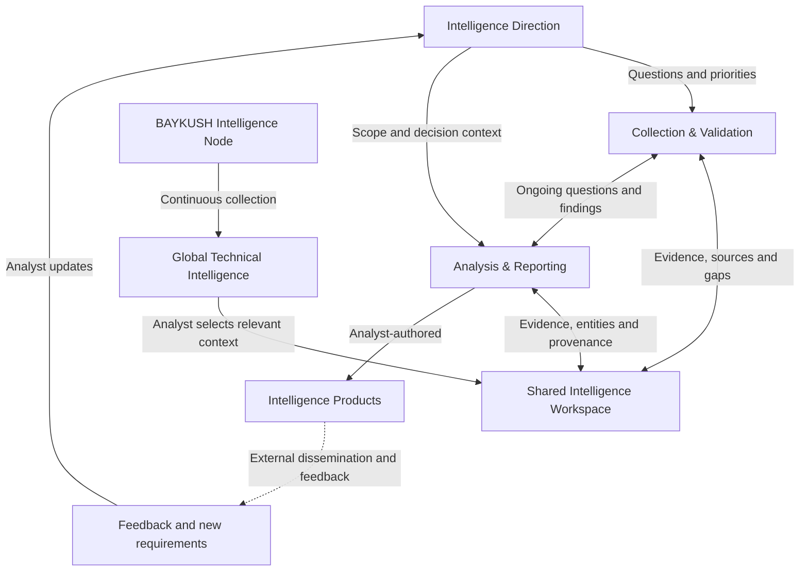

# PREVIEW-1 · Intelligence production architecture

PREVIEW-1 organizes the owner-scoped CİTEM Investigation around how analysts direct, collect, validate, analyze, and report intelligence. The former Production, Research artefacts, Workspace, and Analysis groups exposed peer modules with overlapping responsibilities. The new headings let analysts find work by purpose and return to the same project records from any department.

## Investigation workspaces

| Workspace | Responsibility |
| --- | --- |
| Intelligence Direction | Maintain the primary question, purpose, supporting questions, consumer, decision context, scope, priorities, working knowledge, information gaps, intended product, and deadline. The Investigation root opens the existing Direction workspace. Overview and Intelligence Profile remain separately accessible. |
| 01 — Collection & Validation | Plan collection, link requirements to gaps, register and read sources, annotate material, and evaluate source claims. Source Library and Source Reader expose the existing A–F source reliability workflow. Source Claim details expose assertion credibility (1–6), reporting lineage, and independence through Stage 4.1 M1A–M1C. |
| 02 — Analysis & Reporting | Interpret evidence in Analysis Canvas and Fusion, work with MITRE ATT&CK and existing entities, evaluate attribution, and prepare versioned Intelligence Products. |
| Shared Workspace | Access evidence, indicators, timeline events, graph relationships, notes, tasks, and the existing AI Copilot entry when enabled. Information gaps and Source Claims retain their primary entrances in Direction and Collection while remaining available to the same Investigation owner throughout the workspace. |

Opening a deep link expands its department. Analysts can open any other department with the keyboard or pointer. While the current department is collapsed, its heading identifies the current module. Direction and Collection Planning link to each other. Collection Planning retains its existing gap, requirement, and linked-source views. Scope and gaps are separate sections within Direction.

## Continuous production and feedback

Collection and analysis can proceed concurrently. Analysts trace an assessment to evidence, revisit a Source Claim, or add a gap in Direction and a requirement in Collection Planning when the current record is insufficient. Collection requirement satisfaction and gap resolution remain analyst decisions. Record counts describe workspace contents. Reliability, assertion credibility, analyst confidence, and independent corroboration each retain their existing meaning.

The solid edges below depict existing capabilities and analyst-controlled access. The dashed edge from products depicts dissemination and feedback outside the workspace. Analysts can already use feedback to update Direction manually.

BAYKUSH collects continuously for Global TechINT outside any individual Investigation. Analysts evaluate relevant technical intelligence before using it in an Investigation. Global TechINT navigation, server-side Node access, collection authority, measurements, coverage, and provenance continue to use the existing architecture.

## Route compatibility

All paths below are relative to `/projects/[id]`. An empty tab selection means the root with no `tab` parameter.

| Workspace | Item | Canonical suffix |
| --- | --- | --- |
| Direction | Direction | Investigation root |
| Direction | Investigation Overview | `?tab=overview` |
| Direction | Intelligence Profile | `/intel-profile` |
| Collection | Collection Planning | `/collection` |
| Collection | Source Library | `/sources` |
| Collection | Source Claims & Validation | `/source-claims` |
| Analysis | Analysis Canvas | `/canvas` |
| Analysis | Fusion Workspace | `/fusion` |
| Analysis | MITRE ATT&CK | `?tab=mitre` |
| Analysis | Threat Actors | `?tab=actors` |
| Analysis | Campaigns | `?tab=campaigns` |
| Analysis | Malware | `?tab=malware` |
| Analysis | CVEs | `?tab=cves` |
| Analysis | Infrastructure Analysis | `?tab=infrastructure` |
| Analysis | Attribution | `/attribution` |
| Analysis | Intelligence Products | `/reports` |
| Shared | Evidence Library | `?tab=evidence&view=evidence` |
| Shared | IOC Workbench | `?tab=indicators` |
| Shared | Timeline | `?tab=timeline` |
| Shared | Knowledge Graph | `?tab=graph` |
| Shared | Analyst Notes | `/notes` |
| Shared | Tasks | `?tab=tasks` |
| Shared | AI Copilot | `?tab=ai` when `NEXT_PUBLIC_CITEM_STAGE3_COPILOT_ENABLED=true` |

Nested Source Reader and print views, claim details, entity details, Canvas details, timeline events, infrastructure clusters, report editors, and report versions activate their corresponding modules. Campaign attribution workbenches and hypothesis details activate Attribution. Legacy `?tab=notes` and `?tab=reports` remain reachable and highlight their dedicated navigation items.

## Security and implementation boundaries

The groups organize activities in the existing Investigation. Project access still uses the signed-in user and project-scoped queries under Supabase RLS. Direction and quality endpoints continue to apply their existing ownership checks. Shared resources, immutable review revisions, Canvas relationships, report history, and AI controls use the existing persistence. PREVIEW-1 requires zero migrations. The Investigation root reused the existing Overview before this change. Its edit, linked OSINT, and deletion controls remain at `?tab=overview`.

The new presentation adds no analysis dashboard or structured analysis workbench. Collection Planning continues to expose existing records and linked counts. Review coverage and stale-review aggregates need a dedicated data contract. The Direction summary shows an unavailable state when its existing summary fetch fails.

## Verification and roadmap

Regression tests cover the module keys and links, legacy queries, nested routes, collapse and keyboard behavior, the AI flag, Direction rendering after the existing project lookup, and the Overview path. The navigation component was exercised in Chromium with the application CSS at 1366 × 768, 1920 × 1080, and 390 × 844. The isolated browser fixture verified disclosure, active route indicators, navigation, horizontal overflow, and console errors. Authenticated Investigation pages still need end-to-end acceptance using an authorized Supabase test project.

Stage 4.2 structured hypotheses can join Analysis & Reporting after the accepted baseline includes the workbench. PREVIEW-3 can add a dedicated analytical summary from scoped authoritative data. Future slices cover structured analysis, the MITRE matrix, product templates, Global View and Node reliability, and richer handling of analyst feedback. External dissemination stays an analyst action.
