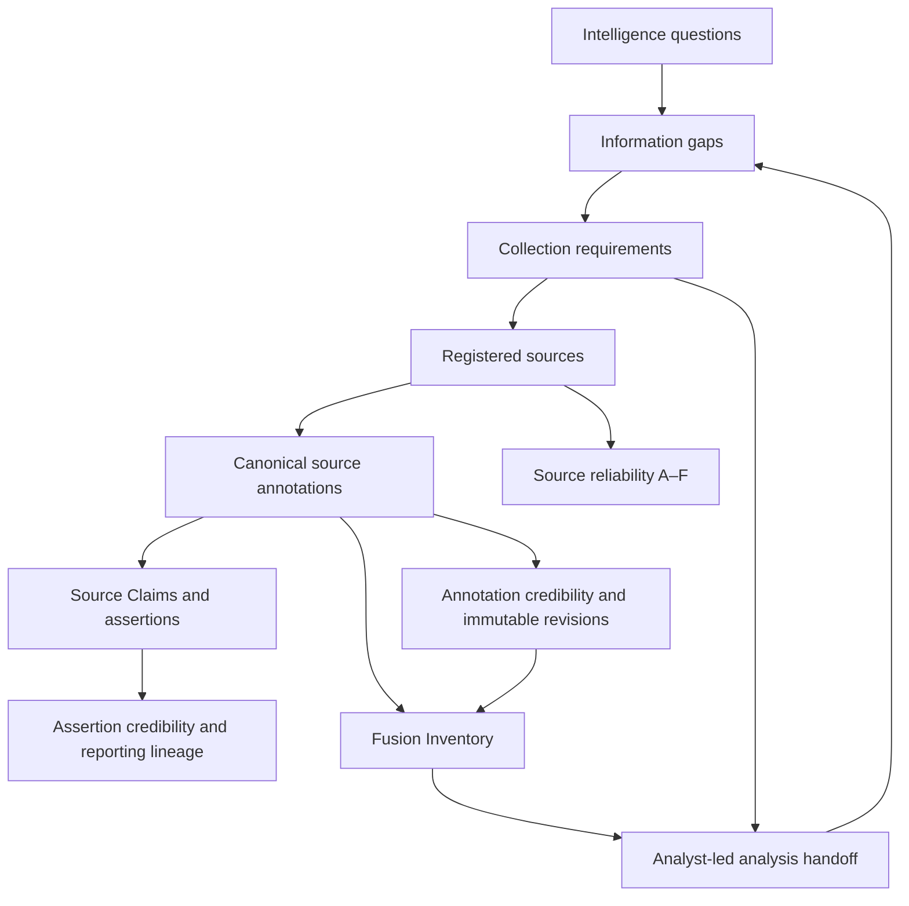

# PREVIEW-2 · Collection & Validation

Collection & Validation remains at `/projects/[id]/collection`. It presents the primary intelligence question, priority, deadline, collection requirements, validation queue and analysis handoff. Collection Planning retains editing, explicit status, gap filtering and source links. Each requirement links to its annotation records in Fusion. Analysts decide when to mark a requirement satisfied and when to resolve each gap. Analysis can begin at any point.

The feature branches independently from main. It uses the existing Collection entry point while PREVIEW-1’s navigation PR #98 is open.

## Metric definitions

All metrics use exact, owner-scoped database counts. A failed request is displayed as Unavailable while the other metrics and Collection Planning remain usable.

| Population | Meaning |
| --- | --- |
| Open directions | Questions in OPEN or PARTIALLY_ANSWERED and gaps in OPEN or PARTIALLY_RESOLVED. |
| Collection requirements | Total includes all states. Individual OPEN, COLLECTING, and SATISFIED counts use existing analyst-assigned statuses. |
| Sources | Collected sources are active registered sources. Archived sources have a separate count. Pending and stale reliability review metrics include active sources. |
| Annotation validation | A passage must be assessable, from an active source, and anchored to a ready asset. No review, matching current review, and stale review are separate states. |
| Assertion validation | Counts assertions attached to active sources using their latest existing review and the four M1B provenance timestamps. |
| Reporting lineage | Counts one recorded current revision per assertion pair. A pair count makes no claim about independence or present validity. |
| Analysis handoff | Counts all retained annotations, Source Claims, indicators and evidence records in the Investigation. The linked gap and collection summaries provide the context for missing information. |

## Fusion and review boundaries

Credibility filters apply to annotations before sorting and pagination. Current grade filters exclude stale reviews. The stale filter retains the previous grade, and Not evaluated includes only assessable passages. Active credibility filters scope results to annotations, including when another record type is selected. Search, provenance, country, grouping and exact unique totals continue to work on that population. A missing review view falls back to the existing inventory with an explicit filter-unavailable message.

Related annotations on derived records retain their independent grades. Their provenance list shows up to 100 referenced annotations. Existing Source Reliability A–F, Assertion Credibility 1–6, Reporting Lineage, and analytical confidence keep their separate meanings and histories. [Annotation Information Credibility](ANNOTATION_INFORMATION_CREDIBILITY.md)

## Migration and acceptance

In an authorized development environment, apply the existing chain through 083 and then apply 085 before enabling annotation assessment and filtering. The new migration is additive. An application rollback can leave the access-controlled review history in place. Dropping the new tables would erase analyst judgments and needs a separate preservation and retention decision.

Use `bash scripts/test-fusion-workspace-migrations.sh` against disposable PostgreSQL 16+ to exercise the full migration chain, ownership, write permissions, idempotency, concurrent revision conflicts, stale state and Fusion filtering. Repository Vitest tests cover request validation, UI behavior, exact metrics and filter fallback. Authenticated browser acceptance requires a separate authorized Supabase test project.

For browser acceptance, register a test source and mark its reliability B. Save three passages, grade two of them 2 and 4, and reload Source Reader. Confirm the same annotation IDs and grades in Fusion, including the unevaluated third passage. Filter by grade and by Not evaluated, revise a passage from Fusion, reopen Source Reader and inspect both revisions. Change passage provenance to verify staleness, check grade 6 and rejection of grade 1, confirm Collection counts and unchanged assertion reviews, then test isolation using a second account.
